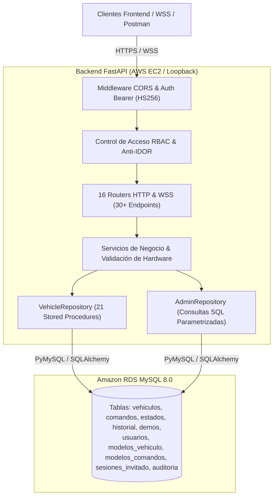

# API IoT de Vehículos · Práctica 4.3: Administración, Control y Monitoreo

Backend desarrollado con **Python, FastAPI, WebSockets (WSS), SQLAlchemy y MySQL en Amazon RDS**, como ampliación modular del proyecto integral de soluciones IoT.

**Desarrollado por:** Ingrid Hernández Gómez · 2026  
**Documentación interactiva Swagger UI:** `https://vehiculo-iot-ingrid.duckdns.org/docs` (o localmente en `http://127.0.0.1:8000/docs`)  
**Frontend publicado:** [https://ingriis.github.io/control-iot/](https://ingriis.github.io/control-iot/)

---

## 1. Arquitectura y Módulos de la API

La API organiza sus servicios en capas desacopladas (`routers`, `services`, `repositories`, `models`, `core`):



---

## 2. Organización de Endpoints en Swagger (`/docs`)

La API integra las **21 rutas existentes de 4.1/4.2** y las **ampliaciones comerciales de 4.3**:

### Módulos de la Práctica 4.3 (Nuevos):
1. **Salud y Diagnóstico:**
   * `GET /health`: Comprobación del servidor API de AWS (200 OK).
   * `GET /health/database`: Consulta directa `SELECT 1` a Amazon RDS MySQL para el indicador del frontend.
2. **Autenticación y Sesiones:**
   * `POST /auth/login`: Autenticación con contraseña hasheada (PBKDF2), emisión de token Bearer (HS256) y registro en auditoría.
   * `POST /auth/logout`: Cierre de sesión y trazabilidad.
   * `GET /auth/me`: Perfil del usuario autenticado.
3. **Modelos Comerciales y Catálogo:**
   * `GET /models`: Catálogo de modelos (Montacargas Arcade, Batman Tumbler).
   * `GET /models/{id}`: Detalle de modelo comercial.
   * `GET /models/{id}/capabilities`: Capacidades de hardware soportadas por el modelo.
   * `POST /models` y `PUT /models/{id}`: Alta y edición de modelos (Solo Administrador).
4. **Administración de Unidades Físicas (Inventario):**
   * `GET /admin/units`: Inventario de unidades físicas con serie, modelo, estado comercial y propietario.
   * `POST /admin/units`: Registro de nueva unidad física con número de serie único.
   * `PUT /admin/units/{id}/assignment`: Asignación a comprador o cambio de estado (`disponible`, `vendido`, `exhibicion`, `inactivo`).
   * `PUT /admin/units/{id}/support`: Habilitación de sesión de soporte operativo en unidades vendidas.
5. **Administración de Clientes:**
   * `GET /admin/clients`: Listado de compradores registrados.
   * `POST /admin/clients`: Alta de comprador con credenciales cifradas y rol `USUARIO`.
6. **Módulo «Mis Vehículos»:**
   * `GET /user/vehicles`: Devuelve **únicamente** los vehículos propiedad del comprador autenticado.
7. **Invitados y Demostración Comercial:**
   * `GET /guest/catalog`: Catálogo público exclusivo de unidades de exhibición.
   * `POST /guest/sessions`: Solicita reserva temporal de 3 minutos (rechaza con `409 Conflict` si está ocupada).
   * `GET /guest/sessions/{token}/status`: Tiempo restante y comandos permitidos.
   * `POST /guest/sessions/{token}/release`: Finaliza la prueba, libera la unidad y emite comando prioritario **DETENER**.
8. **Auditoría del Sistema:**
   * `GET /admin/audit-logs`: Bitácora histórica con actor, rol, acción, recurso, fecha y resultado.

### Módulos Conservados de 4.1 y 4.2 (21 APIs Originales):
9. **Vehículos:** `GET/POST /vehicles`, `GET/PUT/DELETE /vehicles/{vehicle_id}`.
10. **Comandos:** Listar, crear, actualizar y eliminar comandos por vehículo.
11. **Estado:** `GET /vehicles/{vehicle_id}/state` (último estado reportado).
12. **Historial:** `GET /vehicles/{vehicle_id}/history` (máximo 10 movimientos recientes con origen).
13. **Movimientos:** `POST /vehicles/{vehicle_id}/movements` (movimiento manual; persiste en historial en una sola transacción).
14. **Estado de control manual:** `POST /vehicles/{vehicle_id}/control-state` envía el estado completo de las señales independientes (`forward`, `backward`, `left`, `right`) con un lease de seguridad. Requiere una dirección de tracción para activar el giro; todas las señales `false` detienen las salidas.
15. **Demos:** Listar, crear, actualizar, eliminar y ejecutar en `/vehicles/{vehicle_id}/demos`.
16. **Movimientos de Demo:** Administrar pasos ordenados en `/vehicles/{vehicle_id}/demos/{demo_id}/movements`.
17. **Tiempo Real (WebSocket WSS):** `/ws/vehicles/{vehicle_id}` (emite `initial_state`, `movement`, `control_state`, `demo_started`, `demo_finished`, `demo_cancelled` y `demo_error`). Acepta `{"action": "cancel_demo"}`.

---

## 3. Seguridad, RBAC y Aislamiento por Recurso (Anti-BOLA/IDOR)

* **Autenticación Bearer:** El cliente envía el encabezado `Authorization: Bearer <token>` tras iniciar sesión.
* **Roles definidos:** `ADMINISTRADOR`, `USUARIO` e `INVITADO`.
* **Validación de Propiedad:** Para operar movimientos o consultar telemetría, FastAPI valida que el `propietario_id` del vehículo coincida con el `id_usuario` del token. Si se intenta manipular el `vehicle_id` desde Postman o DevTools hacia una unidad ajena, el servidor responde con **`403 Forbidden`**.
* **Protección de Unidades Vendidas:** El Administrador tiene acceso de inventario, pero **no puede mover unidades vendidas** sin que exista una sesión de soporte autorizada explícitamente (`soporte_autorizado = True`).

---

## 4. Base de Datos y Migraciones SQL (Amazon RDS)

El directorio `migrations/` contiene los scripts SQL versionados:
* `001_initial_backup_verification.sql`: Validación de conteos base y procedimiento de respaldo verificable mediante `mysqldump`.
* `002_migration_up_v3.sql`: DDL incremental para crear `usuarios`, `modelos_vehiculo`, `modelos_comandos`, `sesiones_invitado`, `auditoria` y extender `vehiculos` y `demos` de forma no destructiva.
* `003_migration_down_v3.sql`: Plan de reversión seguro para entornos de prueba.
* `docs/migrations-plan.md`: Documentación formal y diagrama Entidad-Relación.

> **Regla de MySQL (Commit Implícito):** En MySQL las operaciones DDL (`ALTER TABLE`, `CREATE TABLE`) provocan un commit implícito inmediato, por lo que no se presume reversión transaccional con `ROLLBACK`.

---

## 5. Preparar y Ejecutar el Backend

### 5.1 Requisitos Previos
* Python 3.10 o superior.
* Servidor MySQL 8.0 en Amazon RDS accesible desde la instancia EC2 o la máquina local.

### 5.2 Configuración de Variables de Entorno (`.env`)
Copia `.env.example` como `.env` y completa los valores correspondientes:

```ini
DB_HOST=tu-instancia-rds.amazonaws.com
DB_PORT=3306
DB_NAME=vehiculo_iot
DB_USER=admin_user
DB_PASSWORD=tu_password_secreto
JWT_SECRET_KEY=clave_aleatoria_larga_para_firma_de_tokens
API_KEY=clave_para_endpoints_heredados
CORS_ORIGINS=https://ingriis.github.io,http://localhost:8081
```

*(El archivo `.env` está estrictamente excluido del repositorio mediante `.gitignore`).*

### 5.3 Instalación y Arranque

En PowerShell o terminal:

```powershell
# Crear entorno virtual
py -m venv .venv
.\.venv\Scripts\Activate.ps1

# Instalar dependencias
pip install -r requirements.txt

# Iniciar el servidor FastAPI
python -m app.main
```

La API escuchará en `http://127.0.0.1:8000`. Accede a la documentación interactiva en:
👉 **[http://127.0.0.1:8000/docs](http://127.0.0.1:8000/docs)**
