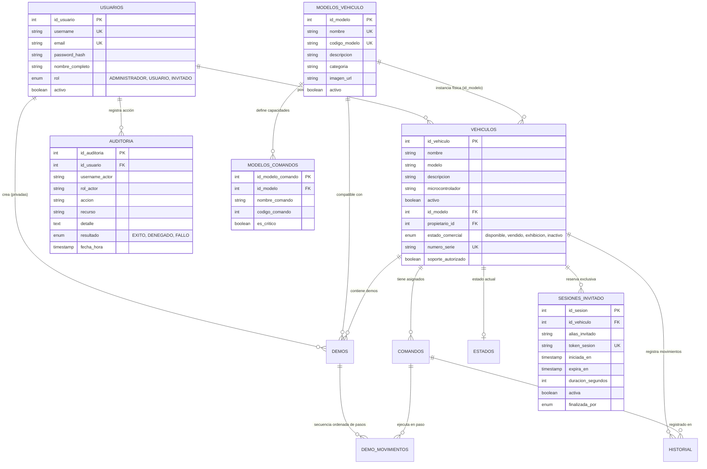

# Plan y Diagrama de Migración · Base de Datos MySQL / Amazon RDS

## 1. Diagrama Entidad-Relación Ampliado (Práctica 4.3)



## 2. Inventario de Tablas y Estrategia de Migración

| Tabla | Estado | Justificación |
|---|---|---|
| `vehiculos` | **Conservada y Alterada** | Se conservan todos los campos y registros para compatibilidad de los 21 Stored Procedures. Se agregan columnas opcionales: `id_modelo`, `propietario_id`, `estado_comercial`, `numero_serie` y `soporte_autorizado`. |
| `comandos` | **Conservada intacta** | Mantiene los códigos y comandos que operan en los microcontroladores y endpoints. |
| `estados` | **Conservada intacta** | Mantiene el estado en tiempo real actualizado por movimientos y demos. |
| `historial` | **Conservada intacta** | Preserva íntegramente los datos históricos registrados en las prácticas 4.1 y 4.2. |
| `demos` | **Conservada y Alterada** | Se agregan campos opcionales (`tipo`: `FABRICA`/`PRIVADA`, `id_usuario`, `id_modelo`) sin alterar los SPs que la consultan. |
| `demo_movimientos` | **Conservada intacta** | Almacena los pasos, orden, duración y pausa de cada demo. |
| `usuarios` | **Nueva** | Manejo de RBAC: `ADMINISTRADOR`, `USUARIO` (comprador) e `INVITADO`. |
| `modelos_vehiculo` | **Nueva** | Catálogo comercial para separar el modelo de catálogo de la unidad física particular. |
| `modelos_comandos` | **Nueva** | Validación de capacidades de hardware por modelo. |
| `sesiones_invitado` | **Nueva** | Control de concurrencia y tiempo de prueba limitado en unidades de exhibición. |
| `auditoria` | **Nueva** | Trazabilidad de operaciones sensibles (altas, reasignaciones, cambios de rol, cancelaciones). |

## 3. Consideraciones de MySQL / Amazon RDS y DDL

> **ADVERTENCIA CRÍTICA: Commit Implícito en MySQL:**
> En MySQL, cualquier sentencia DDL (`ALTER TABLE`, `CREATE TABLE`, `DROP TABLE`, `CREATE INDEX`) provoca un **COMMIT implícito** de cualquier transacción abierta.
> 
> Por lo tanto, no es posible envolver la migración en un `START TRANSACTION ... ROLLBACK`. La ejecución debe realizarse mediante scripts versionados probados previamente, verificando conteos antes y después.

### Pasos de Aplicación en Servidor:
1. **Respaldo previo:**
   ```bash
   mysqldump -h <RDS_ENDPOINT> -u <DB_USER> -p --routines --triggers --single-transaction vehiculo_iot > backup_pre_v3.sql
   ```
2. **Verificación previa:**
   ```bash
   mysql -h <RDS_ENDPOINT> -u <DB_USER> -p vehiculo_iot < migrations/001_initial_backup_verification.sql
   ```
3. **Aplicación UP:**
   ```bash
   mysql -h <RDS_ENDPOINT> -u <DB_USER> -p vehiculo_iot < migrations/002_migration_up_v3.sql
   ```
4. **Verificación posterior:**
   Comprobar que el conteo en `vehiculos`, `comandos`, `estados` e `historial` permanezca idéntico al diagnóstico previo.
